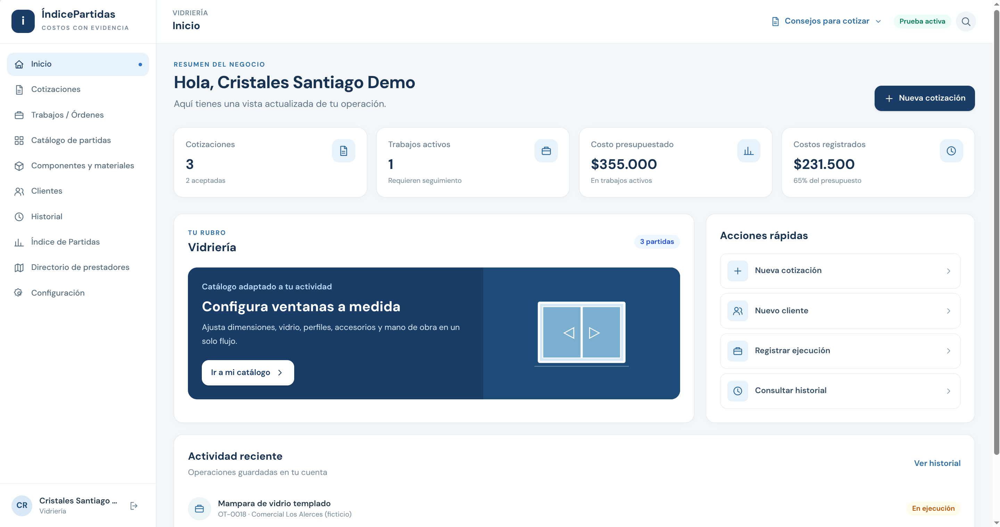
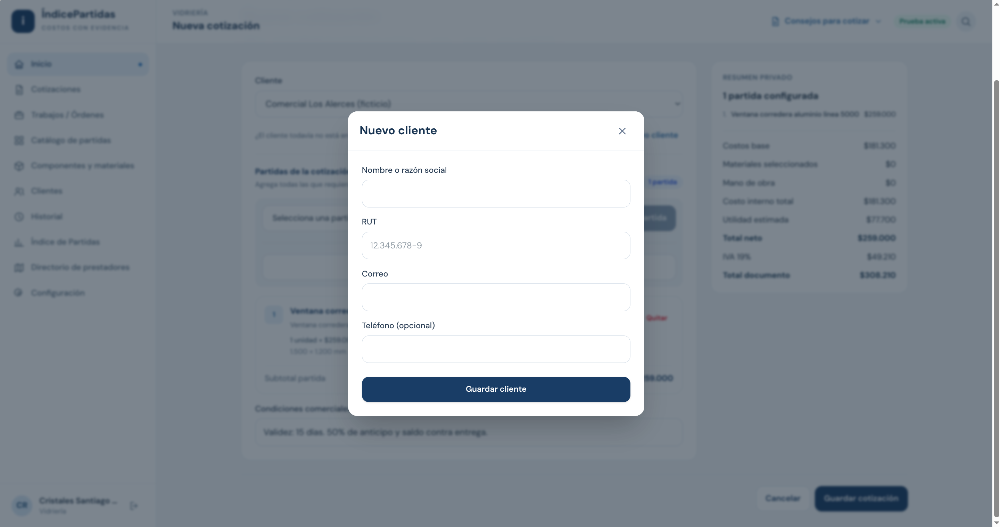
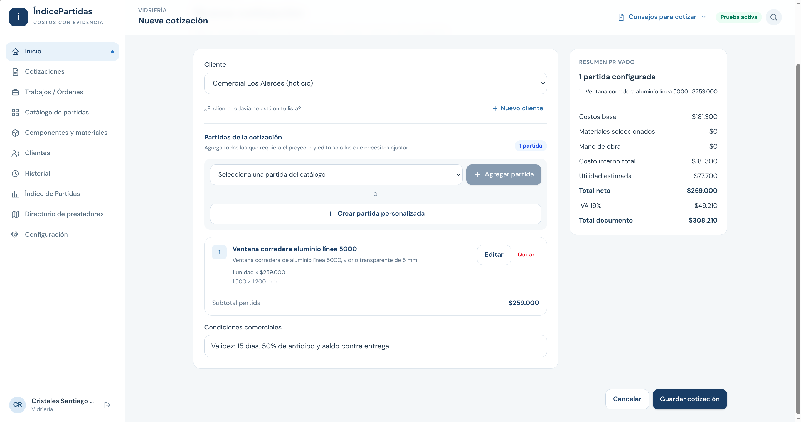
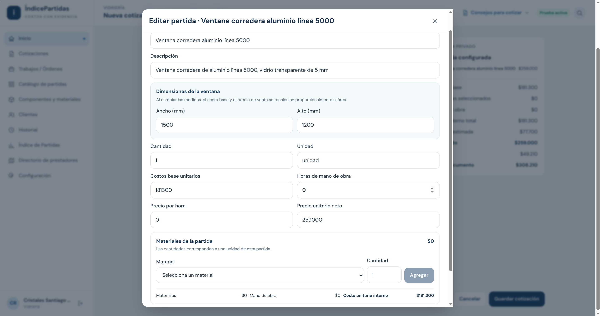
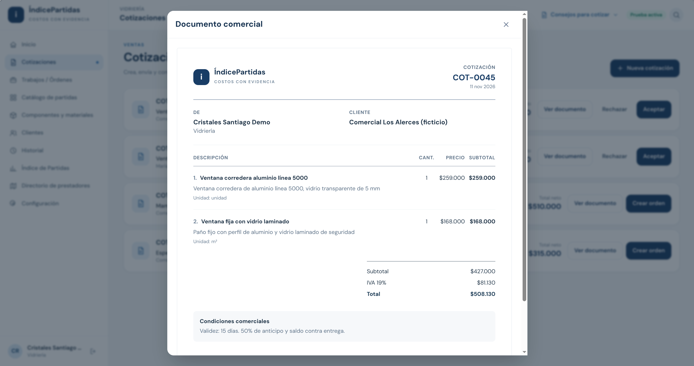
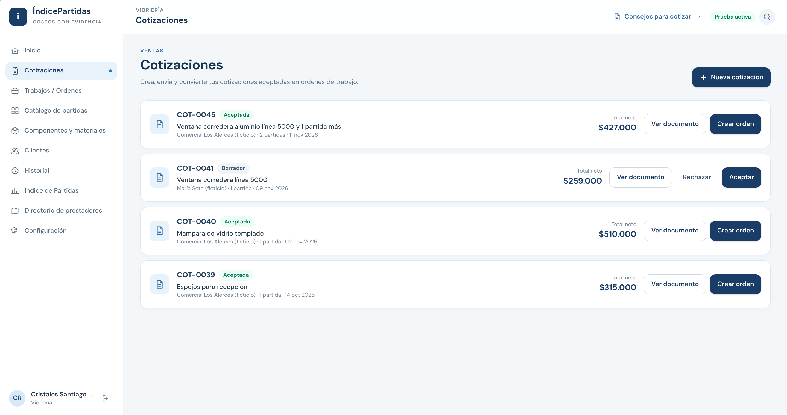
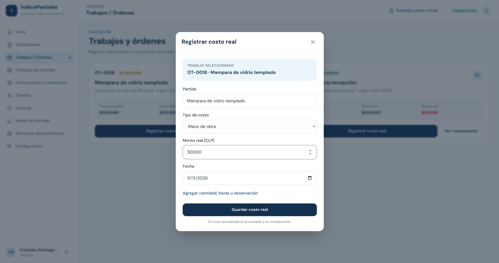
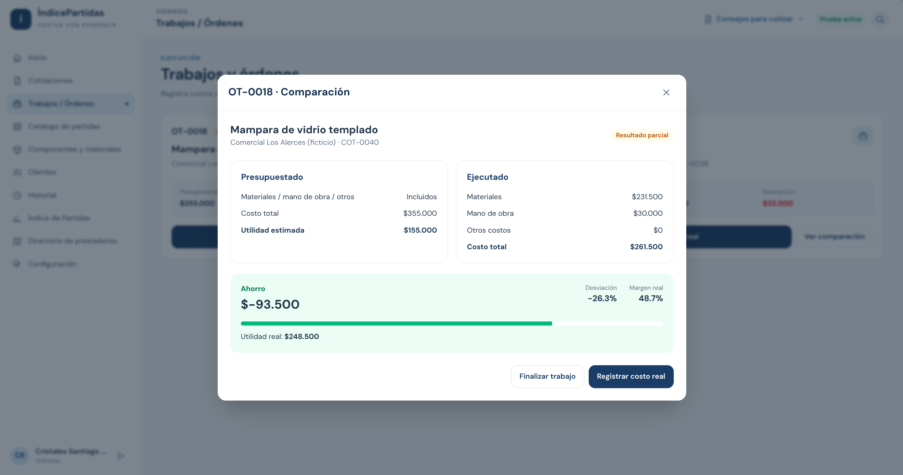

# Prototipo de ÍndicePartidas — PEP 1

## Problema y solución representada

ÍndicePartidas conecta la elaboración de una cotización con el registro del costo de ejecución y su comparación posterior. El recorrido se centra en un contratista o responsable de una pyme de vidriería que necesita preparar presupuestos a medida y saber cuánto lleva gastado en un trabajo.

La primera entrega se representa mediante tres capacidades: **cotizar, registrar ejecución y comparar costos**. La demostración utiliza una interfaz interactiva y datos ficticios; la aceptación de la propuesta se registra manualmente dentro del prototipo.

**Prototipo interactivo:** [index.html](index.html) · **Versión:** PEP1-HTML-01 · [Guía para abrirlo y reiniciarlo](guia-abrir-prototipo.md).

## Recorrido del prototipo

**Acceso → Nueva cotización → Cliente → Partidas y ajustes → Documento comercial → Aceptación y orden de trabajo → Registro de costos → Comparación.**

Las ocho capturas muestran las etapas del recorrido con datos ficticios. Se utilizan distintos presupuestos de demostración: las pantallas no representan una única operación continua. En particular, el registro y la comparación de las capturas 7 y 8 corresponden a la OT-0018, mientras que la propuesta de las capturas 5 y 6 corresponde a la COT-0045. Las capturas ilustran funcionamiento y no son registros de las sesiones de usuarios descritas en el anexo.

### 1. Acceso e inicio

La pantalla de acceso ofrece creación de cuenta, inicio de sesión y acceso demostrativo por rubro. Para el recorrido se utiliza Vidriería. El inicio reúne las cotizaciones, los trabajos activos y los costos presupuestados y registrados, junto con accesos rápidos a las operaciones principales.

Desde **«Nueva cotización»** se abre el editor del presupuesto.

> **Captura 1 — Inicio de Vidriería:** vista general del negocio y acceso «Nueva cotización».

### 2. Cliente y nueva cotización

En **«Nueva cotización»** el usuario selecciona el cliente al que dirige la propuesta. La opción **«Nuevo cliente»** permite registrarlo desde el mismo editor y continuar con ese cliente seleccionado.

La cotización comienza sin partidas o a partir de una plantilla elegida desde el catálogo. Su contenido se construye en la sección **«Partidas de la cotización»**.

> **Captura 2 — Cliente de la cotización:** formulario «Nuevo cliente» abierto desde el editor.

### 3. Incorporación de partidas

El usuario selecciona un elemento del catálogo y pulsa **«Agregar partida»**. Puede incluir varias partidas en una misma cotización o utilizar **«Crear partida personalizada»** para añadir un concepto propio.

Cada tarjeta muestra descripción, cantidad, unidad, precio unitario y subtotal. Las acciones **«Editar»** y **«Quitar»** permiten ajustar la composición del presupuesto antes de guardarlo.

> **Captura 3 — Composición de la cotización:** una partida incorporada, resumen privado y acciones para agregar, editar o quitar. La propuesta con dos partidas se muestra en la captura 5.

### 4. Edición de una partida

La acción **«Editar»** abre el detalle de la partida. El usuario puede modificar nombre, descripción, cantidad, unidad, costos base unitarios y precio unitario neto. También puede incorporar mano de obra mediante horas y tarifa por hora, y seleccionar materiales activos del catálogo con cantidades por unidad de partida.

En partidas de categoría Ventanas aparecen ancho y alto en milímetros. En este editor el costo base y el precio se ajustan proporcionalmente al área de referencia: se trata de una aproximación de la maqueta, no de un cálculo de fabricación certificado.

El detalle diferencia el costo interno del precio de venta. **«Guardar cambios»** aplica el ajuste a la partida de la cotización.

> **Captura 4 — Edición de partida:** cantidades, materiales, mano de obra y resumen de costo interno.

### 5. Resumen y documento comercial

El **«Resumen privado»** reúne costos base, materiales seleccionados, mano de obra, costo interno total y utilidad estimada, además del total neto, IVA y total del documento. El usuario incorpora sus condiciones comerciales y pulsa **«Guardar cotización»**.

La cotización se guarda como borrador y se abre el **«Documento comercial»**. Este presenta cliente, partidas, cantidades, precios de venta, subtotales, IVA y condiciones comerciales; no muestra el desglose privado de costos ni la utilidad interna. **«Imprimir / Guardar PDF»** abre la impresión del navegador.

> **Captura 5 — Documento comercial:** propuesta con partidas, totales y condiciones, sin costos internos.

### 6. Aceptación y orden de trabajo

Desde el documento se utiliza **«Marcar como aceptada»**, o **«Aceptar»** desde el listado de cotizaciones. La aceptación es una acción manual demostrativa: no corresponde a una firma electrónica ni a una confirmación externa del cliente.

La cotización aceptada habilita **«Crear orden»**. La orden queda vinculada a la cotización y conserva su costo presupuestado total y precio de venta neto como referencia. En la versión representada, el seguimiento económico de ejecución se muestra a nivel de orden de trabajo.

> **Captura 6 — Cotización aceptada:** listado con la propuesta COT-0045 aceptada y la acción «Crear orden».

### 7. Registro del costo de ejecución

En **«Trabajos / Órdenes»**, la acción **«Registrar costo real»** abre un formulario con el trabajo seleccionado, tipo de costo, monto y fecha. La demostración utiliza los tipos Material, Mano de obra u Otro para incorporar gastos al trabajo.

Al guardar, el monto se añade a los costos de la orden y actualiza el acumulado. El recorrido documentado se limita a monto, tipo y fecha. Los campos opcionales de cantidad, unidad, horas y observación se muestran en la interfaz, pero sus valores no se guardan en esta versión; quedan fuera del recorrido evaluable. La etiqueta «Monto real (CLP)» tampoco aclara neto o con IVA: no se presenta esa mejora solicitada como resuelta ni se afirma validación tributaria del registro.

> **Captura 7 — Registrar costo real:** identificación del trabajo, tipo, monto y fecha.

### 8. Comparación entre presupuesto y ejecución

La acción **«Ver comparación»** presenta el costo presupuestado de la orden junto al costo registrado, separado en materiales, mano de obra y otros gastos. La desviación expresa la diferencia entre ambos costos, en monto y porcentaje cuando la base permite calcularlo.

El objetivo de esta pantalla es hacer visible cuánto lleva gastado el contratista frente a lo previsto. Mientras no estén incorporados todos los costos aplicables, los resultados económicos se interpretan como provisionales; el costo registrado hasta ese momento no demuestra por sí solo un ahorro final.

La interfaz incluye **«Finalizar trabajo»** y el acceso posterior desde Historial. El cierre representado en la maqueta no constituye una verificación automática de que todos los gastos hayan sido registrados. Al finalizar, la interfaz cambia la etiqueta a «Resultado final» sin comprobar esa integridad; por ello, el recorrido documentado termina en la comparación parcial, sin utilizar el cierre como evidencia de un resultado definitivo. Las etiquetas «Ahorro», «Margen real» y «Utilidad real» también deben interpretarse como provisionales si faltan gastos.

> **Captura 8 — Comparación:** presupuesto, costos registrados y desviación del mismo trabajo.

## Alcance de la demostración

- El recorrido utiliza Vidriería; la aplicación también ofrece Construcción, Electricidad y Otro.
- Las cotizaciones admiten varias partidas y ajustes antes de guardar.
- El presupuesto comercial separa los importes de venta del resumen interno de costos.
- La orden enlaza presupuesto y gastos registrados sin rehacer la cotización.
- Los datos se conservan localmente en el navegador; no se presenta esta maqueta como un servicio productivo con backend, cobros o aceptación externa del cliente.
- Las referencias del índice y los perfiles del directorio son demostrativos y no forman parte del recorrido principal.

## Entrevistas de solución

Las notas de interacción de personas del segmento se reúnen en [pruebas-solucion.md](pruebas-solucion.md). La demostración de funcionamiento y los datos ficticios de las pantallas no se presentan como resultados de entrevistas ni como evidencia de pago.
